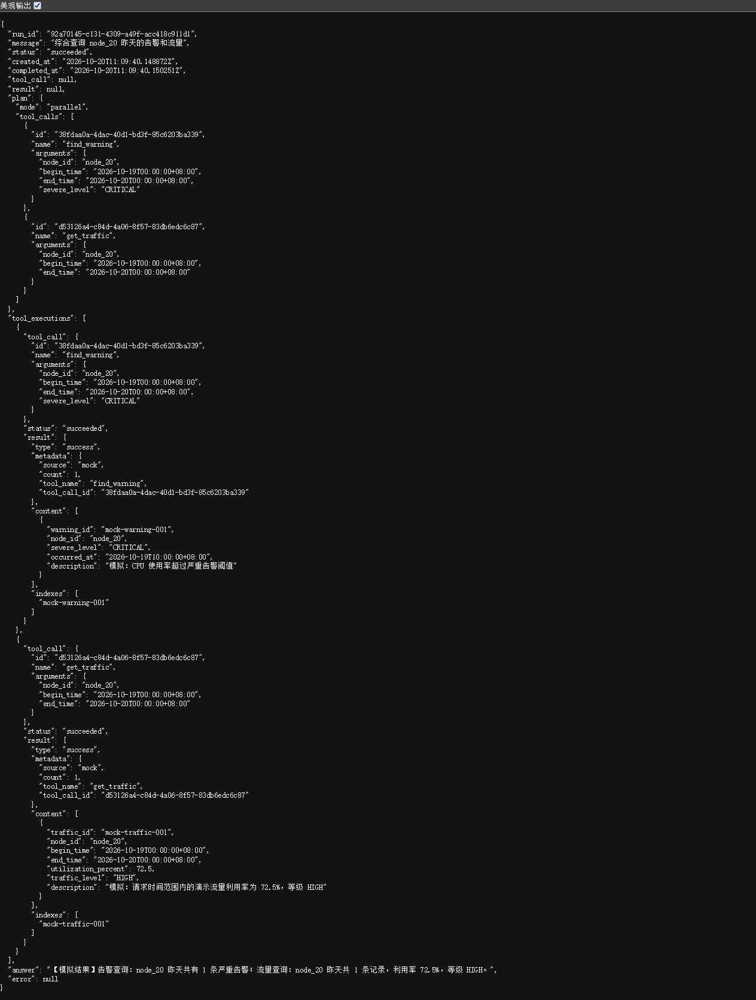

# NetOps Agent Lab — M3.1 交付总结

初次整理及本次演示日期：2026-10-20（Asia/Shanghai）。

本文件集中记录本轮 M3.1 的代码总结、实际测试结果和 Git 差异。阶段总结统一放在 `docs/milestones/`，每个阶段使用一个文档。

第 1–4 节保留初次整理时的代码、测试和 Git 快照：当时仅新增此文档，没有修改业务代码、测试、README 或原有 M2 验收文档，也没有暂存、提交或推送。第 5 节补充随后实际完成的 Swagger 演示、原始响应、截图及复现步骤；README 仅补充最新演示入口。第 1–4 节的提交状态属于当时快照，当前同步状态以 Git 提交历史和远程分支为准。

## 1. Codex 总结

### 1.1 已实现的功能

- 保留原有单工具请求：`查询 node_20 昨天的严重告警` 仍由 Planner 返回 `ToolCall`，原有 `tool_call`、`result` 字段继续保存单工具调用和结果。
- 新增组合请求：`综合查询 node_20 昨天的告警和流量`。Mock Planner 返回显式 `ParallelPlan(mode="parallel")`，包含 `find_warning` 和 `get_traffic` 两个独立调用。组合示例中的告警等级固定为 `CRITICAL`，两个工具使用相同节点及业务时区下的昨天时间范围。
- 新增 `GetTrafficArgs`，要求非空 `node_id`、带时区的起止时间，且 `end_time > begin_time`。工具通过现有 Registry 注册并由原 Runtime 校验和执行。
- 新增可重复的模拟流量数据：利用率 `72.5%`、等级 `HIGH`，`metadata.source="mock"`，记录描述明确包含“模拟”。所有合法请求返回固定演示利用率，不连接真实网络，也不表示真实观测。
- 使用 `asyncio.create_task` 和 `asyncio.gather` 并发执行独立调用；每个调用分别复用 M2 Runtime 的参数校验、Timeout、Retry 和异常分类。编排层不新增重试。
- Run 新增 `plan` 和 `tool_executions`，保存各调用、状态及完整 `ToolResult`。组合请求的顶层 `tool_call`、`result` 为 `null`；单工具请求新增字段默认为 `null`、`[]`。
- 全部工具成功时 Run 为 `succeeded`；任一工具返回错误时为 `failed`，仍等待并保留其他分支结果。多个错误时，Run 顶层错误按计划顺序选择首个，逐工具错误全部保留。
- 按计划顺序生成确定性模拟回答，包含严重告警数量、流量利用率及等级；失败分支显示错误码，同时保留成功分支的汇总。
- 外部取消及子任务取消继续传播 `CancelledError`；编排层取消未完成子任务并等待其结束。Run 保存 `failed / CANCELLED` 和完成时间；被取消分支标记为 `cancelled`。
- `GET /runs/{run_id}` 可查询组合记录；返回深拷贝，避免调用方修改已返回对象时破坏保存结果。

M2 Runtime 默认配置未改变：单次 `timeout=5.0` 秒，`max_retries=3`，每个工具最多执行 4 次。同一工具调用的超时和临时异常共享预算，不同工具各自计算预算。返回的错误结果是已完成结果，不会由并发编排自动触发重试。

### 1.2 M3.1 修改文件

| 文件 | 类型 | 核心职责 |
| --- | --- | --- |
| `main.py` | 修改 | 注册 `get_traffic`；保留原接口和告警工具注册 |
| `netops_agent/models.py` | 修改 | 新增 `ParallelPlan`、`ToolExecution`；Run 增加兼容默认字段 |
| `netops_agent/planner.py` | 修改 | 接口返回 `ToolCall | ParallelPlan`；新增组合请求规则 |
| `netops_agent/tools.py` | 修改 | 新增流量参数、记录模型及模拟工具 |
| `netops_agent/service.py` | 修改 | 根据显式计划类型选择路径，保存各分支并汇总 |
| `netops_agent/orchestration.py` | 新增 | 无依赖调用的并发执行、错误隔离和取消清理 |
| `tests/test_parallel_runs.py` | 新增 | 18 项计划、并发、API、重试及取消测试，含参数化用例 |
| `tests/test_traffic.py` | 新增 | 12 项流量注册、参数校验及模拟结果测试，含参数化用例 |

`runtime.py`、`registry.py` 和原有测试文件未在 M3.1 中重写。工作区中的 `README.md`、`tests/test_runs.py`、`M2_ACCEPTANCE_CHECKLIST.md` 是进入 M3.1 前已有的 M2 未提交成果，已保留，不能算成本轮 M3.1 新修改。

### 1.3 核心执行链

```text
POST /runs
  → MockPlanner.plan(message, registry.schemas())
    → 单工具：ToolCall → 原 ToolRuntime.execute()
    → 组合：ParallelPlan → 初始化逐工具执行记录
      → execute_parallel()
        → gather(find_warning 的 Runtime 执行, get_traffic 的 Runtime 执行)
      → 保存各工具调用、结果和状态
      → 设置 Run 状态，生成确定性 answer
  → 内存保存 Run，返回 201 和 Location
GET /runs/{run_id} → 返回保存记录的深拷贝
```

汇总中会按工具名称选择展示文案；是否并发由 `ParallelPlan` 数据契约决定，不靠工具名称猜测。

## 2. 测试结果与证据

### 2.1 本次实际复跑

执行目录：`D:/work/Demo`。环境变量设置为 `PYTHONUTF8=1`、`PYTHONIOENCODING=utf-8`、`PYTHONDONTWRITEBYTECODE=1`。

新增测试：

```bash
.venv/Scripts/python.exe -B -m pytest -q -W error -p no:cacheprovider tests/test_traffic.py tests/test_parallel_runs.py
```

实际结果，退出码为 0：

```text
30 passed in 0.76s
```

完整 pytest 套件：

```bash
.venv/Scripts/python.exe -B -m pytest -q -W error -p no:cacheprovider
```

实际输出，退出码为 0：

```text
........................................................................ [ 75%]
........................                                                 [100%]
96 passed in 1.39s
```

完整套件包含原有 66 项和 M3.1 新增 30 项；没有删除或弱化原有测试。`-W error` 将警告作为错误处理；`-p no:cacheprovider` 关闭 pytest 磁盘缓存，以避开此前缓存目录的权限问题，不跳过测试；`-B` 禁止生成字节码文件。

### 2.2 新增测试覆盖

参数化展开后的数量如下，所有列出用例均包含在本次通过的 30 项中。

| 测试文件 | 测试函数 | 数量 | 验证内容 |
| --- | --- | ---: | --- |
| `tests/test_parallel_runs.py` | `test_combined_planner_produces_explicit_parallel_plan` | 2 | 有无空格的组合输入；工具名、唯一 ID、共享节点/时间、各自 Schema |
| 同上 | `test_combined_planner_requires_both_registered_tools` | 2 | 缺任一工具时拒绝生成组合计划 |
| 同上 | `test_parallel_plan_contract_rejects_ambiguous_plan` | 3 | 调用数不足、重复 ID、错误执行模式 |
| 同上 | `test_combined_post_and_get_preserve_both_results` | 1 | 两个结果、模拟来源、调用 ID 关联、汇总及 POST/GET 一致性 |
| 同上 | `test_single_query_keeps_original_fields_and_call_type` | 1 | 单工具调用类型及 API 字段兼容 |
| 同上 | `test_parallel_tools_start_before_either_is_released` | 1 | 两个 handler 都已启动但尚未放行；用 Event 确定性证明并发 |
| 同上 | `test_failed_branch_still_collects_later_success` | 2 | 任一工具业务失败后，另一分支仍完成；各执行 1 次，错误详情不泄漏 |
| 同上 | `test_exhausted_traffic_keeps_successful_warning` | 2 | TIMEOUT / TEMPORARY_ERROR 耗尽后保留告警成功结果；调用次数分别为 4 和 1 |
| 同上 | `test_traffic_retry_does_not_repeat_successful_peer` | 1 | 流量临时错误后成功；流量执行 2 次，告警只执行 1 次 |
| 同上 | `test_parallel_cancellation_propagates_and_cleans_children` | 2 | 外部/子任务取消传播、两个 handler 的 finally 清理、无额外执行、Run 状态/错误码/完成时间及 GET 结果 |
| 同上 | `test_combined_snapshot_isolation` | 1 | 修改返回对象的嵌套结果和计划不影响保存记录 |
| `tests/test_traffic.py` | `test_traffic_is_registered_with_parameter_schema` | 1 | 通过原 Registry 注册，必填字段和 extra 禁止规则 |
| 同上 | `test_traffic_result_is_repeatable_and_marked_mock` | 1 | 统一结果类型、模拟标记、重复性、利用率/等级、节点/时间 |
| 同上 | `test_traffic_invalid_arguments_use_existing_runtime` | 7 | 非法节点、错误日期、无时区、错误时间范围和多余字段返回 INVALID_ARGUMENTS |
| 同上 | `test_traffic_arguments_are_required` | 3 | 三个参数分别缺失时校验失败 |

### 2.3 历史验证与本次复跑的区别

上一轮 M3.1 开发结束时已实际记录：新增测试 `30 passed in 0.46s`，完整套件 `96 passed in 1.43s`；当时还启动 Uvicorn，经本机 TCP 验证组合 POST 为 201、GET 为 200 且结果一致，单工具 POST 为 201，OpenAPI 为 200。

上述是本对话的历史执行记录。本次整理重新执行了 2.1 的两个 pytest 命令，没有重新启动 Uvicorn；本次 API 自动化证据来自现有 ASGI 测试，不能将历史 TCP 冒烟检查写成本次新执行结果。

## 3. Git Diff

### 3.1 核对基线与范围

整理时 HEAD：

```text
837c1579c7ef348a004296f199c20171287b493b
```

这是初次整理时的已提交基线，不是 M3.1 的提交号。当时 M3.1 仍为本地未提交修改；暂存区为空，没有提交或推送。

以下统计在创建本总结前读取；统计输出省略 Git 的 LF/CRLF 提示，数值及图形保持实际输出。普通 `git diff` 不包含未跟踪文件，因此需要额外列出新增源码和测试。

### 3.2 当前完整工作区的 git diff --stat

```bash
git diff --stat
```

```text
 README.md               | 160 +++++++++++++++++++++++++++++++++++++++++-------
 main.py                 |   8 ++-
 netops_agent/models.py  |  27 +++++++-
 netops_agent/planner.py |  36 ++++++++---
 netops_agent/service.py |  72 +++++++++++++++++-----
 netops_agent/tools.py   |  40 +++++++++++-
 tests/test_runs.py      | 158 ++++++++++++++++++++++++++++++++++++++++++++++-
 7 files changed, 450 insertions(+), 51 deletions(-)
```

这里的 README 和 `tests/test_runs.py` 差异属于原有 M2 改动。未跟踪的 M2 清单、M3.1 新文件，以及本总结文档均不在这份统计内。

仅筛选 M3.1 已跟踪文件：

```bash
git diff --stat -- main.py netops_agent/models.py netops_agent/planner.py netops_agent/service.py netops_agent/tools.py
```

```text
 main.py                 |  8 +++++-
 netops_agent/models.py  | 27 +++++++++++++++++--
 netops_agent/planner.py | 36 ++++++++++++++++++-------
 netops_agent/service.py | 72 ++++++++++++++++++++++++++++++++++++++-----------
 netops_agent/tools.py   | 40 +++++++++++++++++++++++++--
 5 files changed, 154 insertions(+), 29 deletions(-)
```

### 3.3 新增源码和测试的差异统计

实际分别执行以下命令，没有为查看差异而暂存文件：

```bash
git diff --no-index --stat -- /dev/null netops_agent/orchestration.py
git diff --no-index --stat -- /dev/null tests/test_parallel_runs.py
git diff --no-index --stat -- /dev/null tests/test_traffic.py
```

实际输出依次为（Windows Git 将空设备显示为 `nul`）：

```text
 nul => netops_agent/orchestration.py | 45 ++++++++++++++++++++++++++++++++++++
 1 file changed, 45 insertions(+)

 nul => tests/test_parallel_runs.py | 301 +++++++++++++++++++++++++++++++++++++
 1 file changed, 301 insertions(+)

 nul => tests/test_traffic.py | 65 ++++++++++++++++++++++++++++++++++++++++++++
 1 file changed, 65 insertions(+)
```

三个命令退出码均为 1，表示 `--no-index` 比较发现差异，不是测试失败。

合并已跟踪和新增实现文件，M3.1 共涉及 8 个文件、565 行新增、29 行删除。这是上述实际统计的合计，不是普通 `git diff --stat` 的原始输出；不含 M2 原有修改和本总结文档。

### 3.4 关键代码差异

以下为当前代码关键差异节选，省略无关上下文；新增编排模块完整列出。完整实现仍保存在项目对应文件中。

#### 显式计划与 Run 数据契约：models.py

```diff
+class ParallelPlan(Contract):
+    """调用之间无依赖；列表顺序也是执行记录和汇总结果的展示顺序。"""
+
+    model_config = ConfigDict(revalidate_instances="always")
+
+    mode: Literal["parallel"] = "parallel"
+    tool_calls: list[ToolCall] = Field(min_length=2)
+
+    @model_validator(mode="after")
+    def check_unique_call_ids(self) -> Self:
+        if len({call.id for call in self.tool_calls}) != len(self.tool_calls):
+            raise ValueError("并行计划的 ToolCall.id 必须唯一")
+        return self
+
+class ToolExecution(Contract):
+    tool_call: ToolCall
+    status: Literal["pending", "running", "succeeded", "failed", "cancelled"] = "pending"
+    result: ToolResult | None = None
```

`RunRecord` 新增字段，旧字段继续保留：

```diff
     tool_call: ToolCall | None = None
     result: ToolResult | None = None
+    plan: ParallelPlan | None = None
+    tool_executions: list[ToolExecution] = Field(default_factory=list)
```

#### Planner 接口和组合计划：planner.py

```diff
 class Planner(Protocol):
-    async def plan(self, message: str, tools: list[dict]) -> ToolCall: ...
+    async def plan(self, message: str, tools: list[dict]) -> ToolCall | ParallelPlan: ...
```

```diff
+        if combined:
+            # 此组合示例固定查询严重告警；两个调用没有数据依赖。
+            return ParallelPlan(tool_calls=[
+                ToolCall(name="find_warning", arguments={**common, "severe_level": "CRITICAL"}),
+                ToolCall(name="get_traffic", arguments=common),
+            ])
```

`common` 使用现有时区换算逻辑生成节点、昨天起止时间；单工具分支继续返回 `ToolCall`。

#### 流量参数和模拟返回：tools.py

```diff
+class GetTrafficArgs(Contract):
+    node_id: str = Field(min_length=1)
+    begin_time: AwareDatetime
+    end_time: AwareDatetime
+
+    @model_validator(mode="after")
+    def check_time_range(self) -> Self:
+        if self.end_time <= self.begin_time:
+            raise ValueError("end_time 必须晚于 begin_time")
+        return self
```

```diff
+async def get_traffic(args: GetTrafficArgs) -> ToolResult:
+    # 固定演示利用率；对任意合法节点和窗口返回相同等级，不代表真实观测值。
+    record = TrafficRecord(
+        traffic_id="mock-traffic-001", node_id=args.node_id,
+        begin_time=args.begin_time, end_time=args.end_time,
+        utilization_percent=72.5, traffic_level="HIGH",
+        description="模拟：请求时间范围内的演示流量利用率为 72.5%，等级 HIGH",
+    )
+    return ToolResult(
+        type="success", metadata={"source": "mock", "count": 1},
+        content=[record.model_dump(mode="json")], indexes=[record.traffic_id],
+    )
```

`TrafficRecord` 将利用率限制在 0–100，等级限定为 `LOW / MEDIUM / HIGH`。

#### 工具注册：main.py

```diff
+    registry.register(ToolDefinition(
+        name="get_traffic",
+        description="按节点和时间范围查询模拟流量利用率",
+        args_model=GetTrafficArgs,
+        handler=get_traffic,
+    ))
```

#### 新增编排模块：netops_agent/orchestration.py

该文件是未跟踪的新文件，所以普通 `git diff` 不会显示。以下为实际新增内容：

```python
"""只编排无依赖的并行调用；每个工具仍由现有 Runtime 执行。"""

import asyncio
import logging

from netops_agent.models import ToolExecution, ToolResult
from netops_agent.runtime import ToolRuntime

logger = logging.getLogger(__name__)


async def execute_parallel(runtime: ToolRuntime, executions: list[ToolExecution]) -> None:
    async def execute_one(entry: ToolExecution) -> None:
        entry.status = "running"
        try:
            entry.result = await runtime.execute(entry.tool_call)
        except asyncio.CancelledError:
            entry.status = "cancelled"
            raise
        except Exception:
            # Runtime 之外的未预期异常也不能丢失其他分支；不增加任何重试。
            logger.exception("并行调用 %s 执行异常", entry.tool_call.id)
            entry.result = ToolResult(
                type="error",
                metadata={
                    "tool_name": entry.tool_call.name, "tool_call_id": entry.tool_call.id,
                    "error_code": "INTERNAL_ERROR", "message": "任务执行发生异常。",
                },
                content=[], indexes=[],
            )
        entry.status = "succeeded" if entry.result.type == "success" else "failed"

    tasks = [asyncio.create_task(execute_one(entry)) for entry in executions]
    try:
        await asyncio.gather(*tasks)
    except asyncio.CancelledError:
        # gather 的某个子任务取消时，不会自动取消其余子任务，必须显式清理。
        for task in tasks:
            if not task.done():
                task.cancel()
        await asyncio.gather(*tasks, return_exceptions=True)
        for entry in executions:
            if entry.status in ("pending", "running"):
                entry.status = "cancelled"
        raise
```

#### Service 路径选择、结果保存和状态判定：service.py

路径选择变化；原有单工具处理代码保留在 `else` 分支：

```diff
             call = await self.planner.plan(message, self.runtime.registry.schemas())
-            run.tool_call = ToolCall.model_validate(call)
-            run.result = await self.runtime.execute(run.tool_call)
+            if isinstance(call, ParallelPlan):
+                await self._execute_parallel(run, call)
+            else:
+                run.tool_call = ToolCall.model_validate(call)
+                run.result = await self.runtime.execute(run.tool_call)
```

新增并行结果处理：

```diff
+    async def _execute_parallel(self, run: RunRecord, plan: ParallelPlan) -> None:
+        run.plan = ParallelPlan.model_validate(plan)
+        run.tool_executions = [ToolExecution(tool_call=call) for call in run.plan.tool_calls]
+        await execute_parallel(self.runtime, run.tool_executions)
+        failures = [entry for entry in run.tool_executions if entry.status == "failed"]
+        run.status = "failed" if failures else "succeeded"
+        if failures:
+            # 多个错误时按计划顺序选首个作为 Run 错误，详细结果仍全部保留。
+            metadata = failures[0].result.metadata
+            run.error = RunError(
+                code=str(metadata.get("error_code", "TOOL_ERROR")),
+                message=str(metadata.get("message", "工具执行失败。")),
+            )
+        run.answer = self._summarize_parallel(run.tool_executions)
```

`_summarize_parallel()` 按执行记录的计划顺序组织告警数量和流量利用率/等级；错误分支显示错误码，不覆盖成功分支。原有 `CancelledError` 处理继续保存 Run 的 `CANCELLED` 错误并重新抛出，`finally` 保存完成时间。

## 4. 当前边界

- M3.1 的单工具兼容、两个独立调用并发、结果保存汇总、部分失败、POST/GET 一致性和取消传播，已有当前自动化测试通过证据。
- 并发测试使用 Event 握手确认两个 handler 同时处于未完成状态，不用执行时间差推测并发；这不表示 CPU 计算的多核并行。
- 尚未专门验证：三个及以上工具组合、两个分支同时失败、清理期间重复取消、不配合取消的 handler。取消清理依赖 handler 配合；不宣称能够强制终止任意代码或同步阻塞操作。
- 当前仅支持有限规则的 Mock Planner 和模拟工具，数据保存在单进程内存中，重启会丢失。
- 通用 DAG、Queue、Worker、Checkpoint、数据库、SSE、RAG 和真实 LLM 均未实现；M3.1 测试通过不代表后续 M3 功能或整体项目验收完成。

## 5. 本机 Swagger Demo 与复现步骤（2026-10-20）

本节记录实际启动现有服务后，通过浏览器 Swagger 提交请求的演示。没有新增业务功能或修改 Runtime；演示结果均来自本机真实 HTTP 响应，内容是模拟网络数据。

### 5.1 第一步：检查并启动现有服务

本次先检查了 `git status --short`，保留全部 M2、M3.1 未提交成果；没有拉取旧代码、重置工作区或覆盖文件。确认 8000 端口空闲后，使用项目已有 Uvicorn 入口启动。

你可在 PowerShell 中执行，最后一条命令运行后保持终端打开：

```powershell
$OutputEncoding = [Console]::OutputEncoding = [Text.UTF8Encoding]::new($false)
Set-Location "D:/work/Demo"
.venv/Scripts/python.exe -m uvicorn main:app --host 127.0.0.1 --port 8000
```

看到 `Uvicorn running on http://127.0.0.1:8000` 后，打开 <http://127.0.0.1:8000/docs>。绑定地址为本机，不是公网部署。

### 5.2 第二步：提交组合请求，检查实际 Server response

1. 展开 `POST /runs`，点击 **Try it out**。
2. 用下列内容替换请求体，点击 **Execute**。
3. 查看实际 **Server response / Response body**，不要把下方预生成的 Example Value 当成执行结果。

```json
{"message":"综合查询 node_20 昨天的告警和流量"}
```

本次实际返回 HTTP **201**：

| 核对项 | 实际结果 |
| --- | --- |
| `run_id` | `92a70145-c131-4309-a49f-acc418c911d1` |
| `status` / `error` | `succeeded` / `null` |
| `plan.mode` | `parallel` |
| `tool_executions` | 2 条，分别为 `find_warning`、`get_traffic` |
| 每个工具的 `status` / `result.type` | `succeeded` / `success` |
| 每个工具的 `result.metadata.source` | `mock` |
| 告警结果 | 1 条严重告警，索引 `mock-warning-001` |
| 流量结果 | 利用率 `72.5`，等级 `HIGH`，索引 `mock-traffic-001` |

原始完整响应：[combined-post.json](assets/m3.1/combined-post.json)。

### 5.3 第三步：用 POST 返回的 run_id 查询保存记录

1. 展开 `GET /runs/{run_id}`，点击 **Try it out**。
2. 在 `run_id` 输入框填入上一步返回的 ID，点击 **Execute**。
3. 检查两个工具结果、汇总回答和 Run 状态，而不只检查 HTTP 状态码。

本次实际 GET 路径为：

```text
http://127.0.0.1:8000/runs/92a70145-c131-4309-a49f-acc418c911d1
```

Swagger 返回 HTTP **200**。从 POST 和 GET 页面分别读取实际 Response body 并解析为 JSON 后，比较结果完全相等；随后还通过 HTTPX 访问本机 TCP 服务，再次核对保存记录与导出的 JSON 一致。

实际保存的汇总回答为：

> 【模拟结果】告警查询：node_20 昨天共有 1 条严重告警；流量查询：node_20 昨天共 1 条记录，利用率 72.5%，等级 HIGH。

原始完整 GET 响应：[combined-get.json](assets/m3.1/combined-get.json)。

这是单进程内存保存，不是数据库持久化。重启服务后，该 ID 会失效；你重新演示时必须先 POST，再使用新返回的 ID，不能一直复用本文 ID。

### 5.4 第四步：验证原有单工具查询

回到 `POST /runs`，把请求体改成以下内容并再次执行：

```json
{"message":"查询 node_20 昨天的严重告警"}
```

本次 Swagger 实际返回 HTTP **201**，Run ID 为 `ef006515-7f62-42e8-99fc-625810cccb27`。状态为 `succeeded`，`tool_call.name` 为 `find_warning`，`result.type` 为 `success`，`plan` 为 `null`、`tool_executions` 为 `[]`；回答为“【模拟结果】node_20 昨天共有 1 条严重告警。”。另通过真实 HTTP GET 确认保存的单工具记录与 POST 响应一致。

原始完整响应：[single-post.json](assets/m3.1/single-post.json)。

### 5.5 演示截图与本次测试

下图为同一个组合 Run 的 GET 响应，浏览器开启 JSON 美观输出后直接截取完整页面，没有修改响应内容，也没有拼接或生成假页面。它与 Swagger POST 返回的 JSON 完全一致，可查看两个执行结果和末尾汇总。



本次演示前再次运行完整测试套件：

```bash
.venv/Scripts/python.exe -B -m pytest -q -W error -p no:cacheprovider
```

实际结果：`96 passed in 1.36s`，退出码 0。这是本次演示的复跑结果；第 2 节保留初次文档整理及更早开发时的运行记录，不能混为同一次执行。

### 5.6 第五步：Diff 检查与 Git 同步

本批次统一保留原有 M2 文档/API 测试，以及 M3.1 实现、测试、总结和演示材料。提交前查看 Diff、核对文件清单、检查秘密信息，再暂存明确列出的文件；不使用覆盖工作区、强制推送或关闭 TLS 校验的方式同步。

你以后可用下面顺序复现 Git 检查；暂存时应按实际文件清单选择路径，而不是盲目加入所有文件：

```bash
git status --short
git diff --check
git diff --stat
# git add -- <本次确认的文件路径>
git diff --cached --stat
git diff --cached
# git commit -m "<说明本次修改>"
git push origin main
git log -1 --oneline
git ls-remote --heads origin main
```

本机没有 `gh` 命令；现有 Git Credential Manager 可以用于已配置的 GitHub 远程仓库，不需要为本次演示安装 GitHub CLI。具体提交号和推送结果在执行后核实，不预先写成成功。

演示完成后可在启动服务的终端按 `Ctrl+C` 停止服务。对外展示时可描述为“基于模拟告警和流量的多工具 Agent 执行闭环”，不能描述为已经连接真实网络、开展真实网络监控或完成生产部署。
