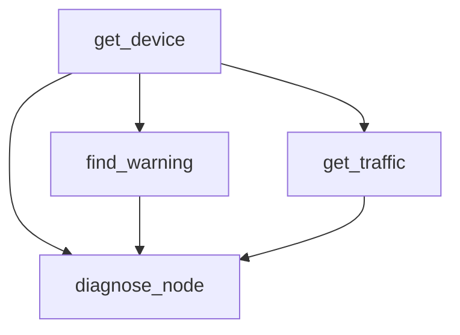

# NetOps Agent Lab — M3.2 DAG 依赖调度与结果传递

本次验证日期：2026-10-20（Asia/Shanghai）。本阶段待代码审查，未自动提交或推送。

## 1. 基线与修改范围

开始时工作区干净，分支为 `main`，HEAD 与 `origin/main` 均为 `fed1b6afc3f215fcfff66f56b663ccfa531df5d0`。先阅读实际代码及现有测试，再复跑 M3.1 基线：`96 passed in 1.36s`。

| 文件 | 修改内容 |
| --- | --- |
| `netops_agent/models.py` | DAGPlan / DAGStep / ResultBinding；执行记录增加带默认值的依赖、绑定、错误字段及 blocked 状态，Run.plan 兼容两种计划 |
| `netops_agent/planner.py` | 新增明确的诊断规则和四步 DAG；原单工具和 ParallelPlan 分支保留 |
| `netops_agent/tools.py` | 新增模拟设备与诊断工具、参数模型、实际输入证据校验 |
| `netops_agent/dag.py` | 新增分批 DAG 调度、深拷贝结果绑定、blocked 传播和取消记录 |
| `netops_agent/service.py` | 新增 DAG 路径、逐步骤记录、错误及回答汇总 |
| `main.py` | 通过已有 Registry 注册 get_device 和 diagnose_node |
| `tests/test_dag_models.py` | 新增 17 项契约与可变模型校验测试 |
| `tests/test_dag_runs.py` | 新增 28 项 Planner、调度、API、失败隔离、重试及取消测试 |
| `tests/test_diagnostic_tools.py` | 新增 16 项注册、参数、模拟设备和诊断证据测试 |

本阶段没有修改 `runtime.py`、`registry.py`、M3.1 的 `orchestration.py` 或任何已有测试。此文档及原始 HTTP 响应仅用于本阶段验证归档；README、M2 清单和 M3.1 演示材料保留。

## 2. 数据契约与执行链

- `DAGPlan(mode="dag", steps=[...])` 与原 `ParallelPlan(mode="parallel")` 是两种显式契约。原单工具仍返回 `ToolCall`。
- `DAGStep.tool_call.id` 是唯一的步骤 ID，不再另存第二个 ID。
- `depends_on` 保存直接依赖 ID；`bindings` 保存 `source_step_id` 与 `target_argument`。
- 绑定只支持将来源 `ToolResult.content` 整体注入目标的一个顶层参数，不实现任意 JSONPath、模板或表达式。
- 模型拒绝空计划、重复 ID、未知依赖、自依赖、环、重复依赖、非直接来源绑定、重复绑定目标，以及绑定与静态参数冲突。
- 环检测使用 Python 标准库 `graphlib.TopologicalSorter.prepare()`；未知依赖在调用它之前显式拒绝。
- DAG 模型在执行前重新校验；对构造后被修改的嵌套 ToolCall，也在 DAGStep 边界重新校验。没有改变旧 ToolCall 的全局行为。

执行关系：



诊断对设备步骤也声明直接依赖，因为设备 content 的绑定来源必须是直接依赖。告警查询固定为 `CRITICAL`。get_device 返回模拟设备基础信息，不提供历史设备状态数据库。

调度器从通过校验的计划初始化执行记录，逐批选出依赖均成功的步骤，调用原 `execute_parallel` 并发执行本批次。当前批次全部结束后重新计算就绪步骤；这是批次调度，不宣称下游会在其他同批无关慢分支完成前立即启动。

绑定时复制静态参数及上游 content，再经原 ToolRuntime 做工具查找、Pydantic 校验、超时重试和返回值校验。原计划不写入绑定值；实际注入后的参数保存在 `tool_executions[*].tool_call.arguments`。

### 失败与取消

- 任一步骤执行失败时，保存原错误结果和错误码；其他独立分支仍有执行机会。
- 失败依赖的下游为 `blocked`，`error.code="DEPENDENCY_FAILED"`，`result=null`，handler 不执行，也不注入失败结果。
- 全部步骤成功时 Run 为 succeeded；任一步骤 failed 或 blocked 时 Run 为 failed。顶层错误优先选取计划顺序中的实际失败步骤，逐步骤错误仍完整保留。
- 外部或子任务取消由原 execute_parallel 取消并等待当前批次子任务，DAG 层将尚未执行步骤也标记 cancelled，继续向上传播 CancelledError。Run 保存 failed/CANCELLED 和完成时间；已成功分支保留。
- Runtime 的 `timeout=5.0`、`max_retries=3`、最多 4 次尝试、超时与临时错误共享预算及异常分类均未改动；调度器不额外重试。

## 3. 测试命令及实际结果

均在 `D:/work/Demo` 使用现有虚拟环境执行，保留警告检查，关闭 pytest 缓存和字节码写入。

新增测试：

```bash
.venv/Scripts/python.exe -B -m pytest -q -W error -p no:cacheprovider tests/test_dag_models.py tests/test_dag_runs.py tests/test_diagnostic_tools.py
```

```text
61 passed in 0.98s
退出码：0
```

完整套件：

```bash
.venv/Scripts/python.exe -B -m pytest -q -W error -p no:cacheprovider
```

```text
157 passed in 2.56s
退出码：0
```

157 项包含原有 96 项和新增 61 项，没有删除或弱化旧测试。

| 验证项 | 当前测试证据 |
| --- | --- |
| DAG 结构和绑定规则 | `test_valid_dag_accepts_unordered_steps_and_reuses_call_ids`、`test_invalid_dag_is_rejected` |
| 可变模型再次校验 | `test_mutated_dag_is_revalidated`、`test_dag_step_revalidates_mutated_tool_call` |
| 诊断计划及注册工具检查 | `test_diagnostic_planner_declares_dependencies_and_content_bindings`、`test_diagnostic_planner_requires_all_tools` |
| 根节点并发、无序计划 | `test_root_steps_run_concurrently_and_unordered_dependency_waits` |
| 设备先执行、两个就绪分支并发、诊断等待 | `test_device_then_ready_branches_then_diagnosis_uses_event_barriers` |
| 深拷贝、原计划和来源结果不受影响 | `test_content_bindings_are_deep_copies_and_leave_plan_unchanged` |
| 绑定后仍由 Runtime 校验，非法参数 handler 不执行 | `test_bound_arguments_are_validated_by_runtime_before_handler` |
| 故障分类、调用次数、阻断传播及独立成功分支 | `test_failed_upstream_blocks_descendants_but_preserves_other_branch` 的 8 类故障 |
| 实际设备/告警失败时诊断不执行，告警失败保留流量 | `test_diagnostic_failure_blocks_required_descendants_without_losing_traffic` |
| 超时/临时错误重试成功，只传最终成功结果 | `test_dag_retry_success_only_passes_final_success_downstream` |
| 诊断根据修改后的上游结果变化，非固定伪造 | `test_diagnosis_uses_modified_upstream_evidence_instead_of_fixed_samples`：DOWN、两条严重告警、5.0% / LOW 和自定义证据 ID |
| POST/GET 保存完整计划、绑定参数及结果 | `test_diagnostic_post_get_preserve_plan_bound_arguments_and_results` |
| 外部/子任务取消及资源释放 | `test_dag_cancel_propagates_waits_for_cleanup_and_saves_future_steps`：根节点/中间批次共 4 种场景，验证异步 finally、锁释放、调用次数及 GET 保存结果 |

这些调度与并发测试用 asyncio.Event 建立握手，不通过耗时差判断并发。故障测试覆盖 BUSINESS_ERROR、TEMPORARY_ERROR、TIMEOUT、UNKNOWN_TOOL、INVALID_ARGUMENTS、INVALID_TOOL_RESULT、直接返回 error 和未知异常。

开发中实际遇到并修正的情况：

1. 初始新增测试因模型/函数未实现而收集失败，随后补齐实现。
2. 一项故障夹具让健康 handler 在 0.01 秒期限内等待另一个工具的 4 次超时预算，导致健康分支自身超时；调整该场景的握手，让健康分支独立完成，其余故障仍验证后完成的成功分支。保留全部错误码、执行次数及阻断断言，没有修改 Runtime。
3. 3 项复核测试发现可变嵌套 ToolCall 未重新校验的问题，已用 DAGStep 的局部字段校验修复；修复后新增及完整套件均通过。

## 4. 最终代码的真实 HTTP 执行记录

在独立的临时 Uvicorn 服务 `127.0.0.1:8001` 上，通过 HTTPX 的真实 TCP 请求执行：

```http
POST /runs
Content-Type: application/json

{"message":"诊断 node_20 昨天的设备状态、告警和流量"}
```

本次最终代码的 Run ID：`93425927-d2ca-40fa-a60e-0370320899c0`。

| 步骤 | 直接依赖（为便于阅读显示名称，实际保存 UUID） | 状态 | 实际结果 |
| --- | --- | --- | --- |
| get_device | 无 | succeeded | 模拟设备 UP，索引 mock-device-node_20 |
| find_warning | get_device | succeeded | 1 条 CRITICAL 告警，索引 mock-warning-001 |
| get_traffic | get_device | succeeded | 模拟利用率 72.5%，等级 HIGH |
| diagnose_node | get_device、find_warning、get_traffic | succeeded | 根据以上三份真实上游 content 计算，诊断等级 CRITICAL |

本次实际汇总：

> 【模拟结果】get_device 成功；find_warning 成功；get_traffic 成功；【模拟诊断】node_20：设备状态 UP；严重告警 1 条（告警总数 1）；最大流量利用率 72.5%，等级 HIGH；诊断等级 CRITICAL。

检查结果：

- POST HTTP 201，Run 为 succeeded、error 为 null，四个步骤均成功。
- 使用返回的 Location / run_id 发起 GET，HTTP 200，完整 JSON 与 POST 相等。
- 比较诊断调用中的 device_info、warnings、traffic 与三个上游 content，分别完全相等；原计划的诊断静态参数仍只有 node_id。
- 新服务的 /docs、/openapi.json 可访问，Schema 中包含 DAGPlan。
- 同一新服务中的单工具和 ParallelPlan 请求均 POST 成功，GET 结果一致。
- 演示期间，原 8000 M3.1 服务一直可访问，原组合 Run 与此前保存的 JSON 一致。
- 新版临时 8001 服务已正常停止；没有停止或重启原 8000 服务。

完整原始 POST 响应归档在 [dag-run.json](assets/m3.2/dag-run.json)，包含步骤 UUID、依赖、显式绑定、实际注入参数、ToolResult、状态和错误字段。GET 与此文件逐对象比较一致。该临时服务已关闭，内存 Run 随其结束失效；再次演示需先创建新 Run，不能直接复用本文 ID。

审查时可独立启动新版本，不影响 8000：

```powershell
.venv/Scripts/python.exe -m uvicorn main:app --host 127.0.0.1 --port 8001
```

然后访问 <http://127.0.0.1:8001/docs> 提交上述请求。

## 5. 验收范围与尚未验证的边界

本阶段新增契约、批次 DAG 调度、结果绑定、模拟诊断及现有路径回归已具备当前自动化和上述 TCP/HTTP 成功路径证据。代码等待审查，没有自动提交或推送，不能据此宣称后续模块或整体工程已完成。

尚未验证或未实现：

- 大规模 DAG 的性能、并发数量上限与内存容量控制；当前未增加并发限流。
- 清理过程中连续多次取消、吞掉 CancelledError 的 handler、同步阻塞代码；现有取消依赖 handler 配合，不提供强制终止。
- 任意 JSONPath、嵌套目标绑定、条件/可选步骤、动态增图和重试退避；当前步骤都视为必要步骤。
- 真实设备、网络、连接池或外部工具；所有设备、告警、流量和诊断都明确为 mock。
- Queue、Worker、Checkpoint、数据库、SSE、RAG 和真实 LLM。

当前没有需要用户补充才能继续的阻塞问题。8000 的旧进程仍运行 M3.1，磁盘代码是待审查 M3.2；这两个版本刻意使用不同端口验证，后续升级演示进程需另行有序操作。
